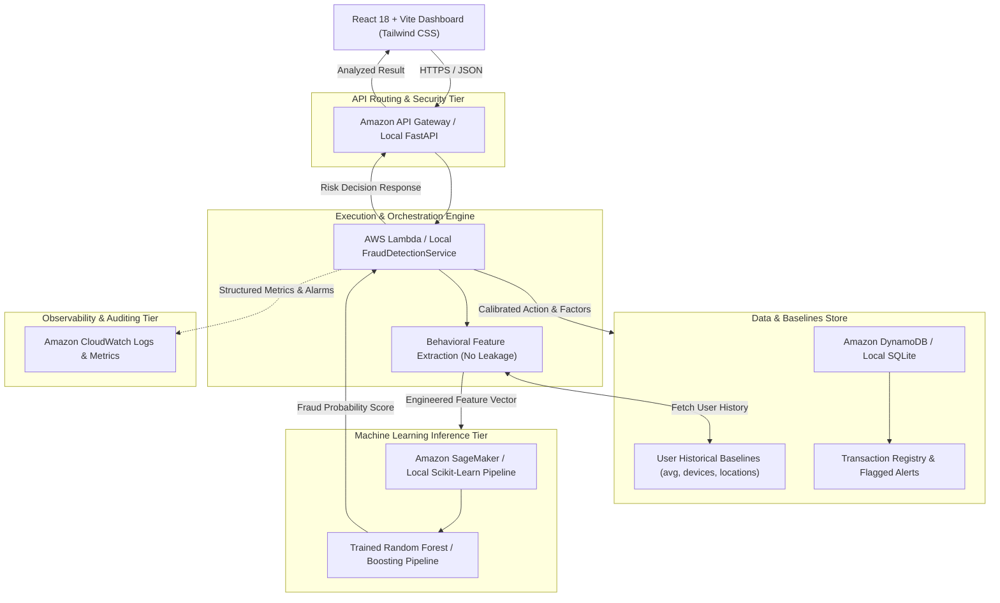
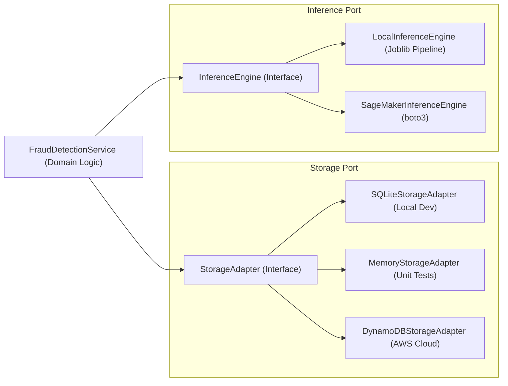

# AWS FraudShield — Architecture Documentation

This document describes the architectural design of **AWS FraudShield**, highlighting the decoupled hexagonal design that enables 100% functional local execution without cloud credentials alongside production deployment on Amazon Web Services.

---

## 1. System Architecture Overview

AWS FraudShield separates presentation, API routing, business domain logic, behavioral feature engineering, and storage adapters.

---

## 2. Decoupled Hexagonal Storage and Inference Pattern

To allow students and developers to experiment without incurring AWS cloud charges, FraudShield applies the hexagonal port-adapter pattern:

---

## 3. End-to-End Transaction Analysis Lifecycle

1. **Transaction Ingestion**: The e-commerce client submits a simulated transaction payload containing `transaction_id`, `user_id`, `amount`, `merchant`, `location`, `device_id`, and `timestamp`.
2. **Deterministic Idempotency Check**: The service checks if the `transaction_id` has already been processed to prevent duplicate scoring or double-charging.
3. **Historical Profile Retrieval**: The system queries the customer's behavioral baseline (`avg_amount`, `std_amount`, `known_devices`, `frequent_locations`, `frequent_merchants`). If the customer has no history, safe population-wide defaults are used.
4. **Behavioral Feature Engineering**: Computes behavioral deviation metrics strictly using data known *before* or *at the time of* the transaction:
   - `amount_to_avg_ratio`: Ratio of current transaction to historical spend
   - `amount_z_score`: Standard deviations from baseline
   - `is_device_known`: Binary indicator of hardware fingerprint recognition
   - `is_location_unusual`: Binary indicator of geographic mismatch
   - `is_merchant_familiar`: Prior familiarity with the merchant
   - Temporal features: Hour of day, day of week, night-time transaction window
5. **Probabilistic Risk Scoring**: The feature vector is passed to the machine learning model pipeline, which outputs continuous probability $P(\text{Fraud} = 1 \mid X)$.
6. **Policy Calibration & Decision Action**:
   - $\text{Score} < 0.30 \implies \text{LOW Risk} \implies \text{APPROVE}$
   - $0.30 \le \text{Score} < 0.70 \implies \text{MEDIUM Risk} \implies \text{VERIFY_MFA}$
   - $\text{Score} \ge 0.70 \implies \text{HIGH Risk} \implies \text{FLAG_FOR_REVIEW}$
7. **Transparent Risk Factors**: Rule-based signals (such as "Transaction amount ₹10,000 is 13.3x higher than user average" and "Unseen device") are paired with the prediction.
8. **Persistence**: The transaction and decision are recorded to the database.
9. **Analyst Review**: Flagged transactions enter the Security Operations Queue for human-in-the-loop audit and feedback.

---

## 4. Security & Cloud Architecture Specifications

### Least-Privilege IAM Boundary
The AWS Lambda execution role (`FraudShieldLambdaRole`) is scoped strictly to:
- `dynamodb:PutItem`, `dynamodb:GetItem`, `dynamodb:UpdateItem`, `dynamodb:Query`, `dynamodb:Scan` on `FraudShieldTransactions` and `FraudShieldUserProfiles`
- `sagemaker:InvokeEndpoint` on `fraudshield-xgb-endpoint`
- `logs:CreateLogGroup`, `logs:CreateLogStream`, `logs:PutLogEvents` on `/aws/lambda/fraudshield-processor`

### Production Authentication
For production deployment, Amazon Cognito User Pools or API Gateway Lambda Authorizers (OAuth 2.0 / JWT) should be attached to protect endpoints against unauthenticated access.
